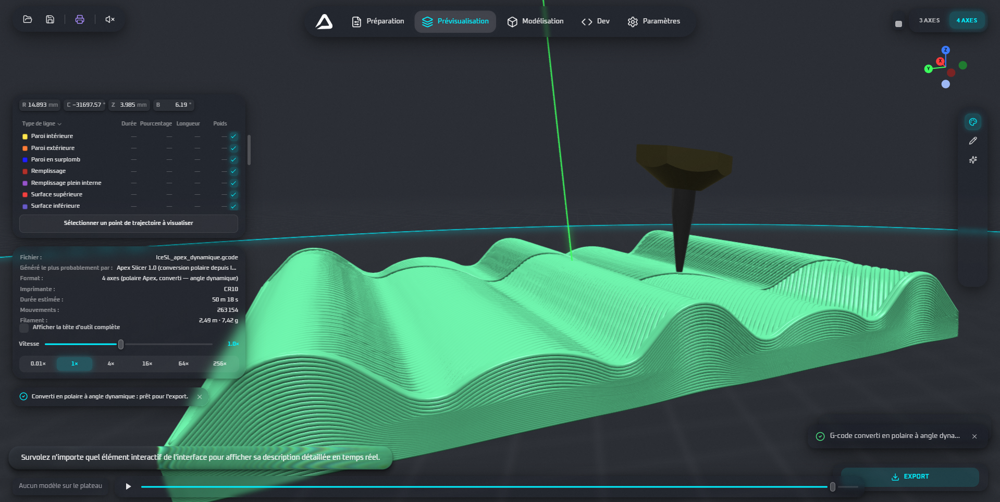

#  Apex Slicer UI

[English](README.md) | [Français](README-fr.md) | [Čeština](README-cz.md)

The future UI for Apex Slicer, including modern UX effects. Still in developement.

## Online Demo

[Online Demo is here, but you can experience some serious lag issues with your browser, it is recommended to compile first](online.demo.apex.aeloxhardware.com)

## Screenshots

<table align="center">
  <tr>
    <td></td>
    <td></td>
  </tr>
  <tr>
    <td></td>
  </tr>
</table>

## Features

**✨ Modern User Experience:**

- Fluent Interface
- Liquid Glass Effects
- Fluid Animations
- Floating Elements
- Merging Tools
- Anti-aliasing

## Technical Highlights

- WebGL2 / WebGPU dual-backend rendering for high-performance graphics
- Multipass rendering for high-quality & performant Gaussian blur
- Using SDF Defined shapes and smooth merge function
- Custom shader implementations for realistic glass effects
- Custom Leva UI components for intuitive parameter controls

## TODO

- [x] Floating 3/4/5-Axis Selector
- [ ] Light Theme
- [ ] Toolbar Moving
- [ ] Liquid Jello Menus
- [ ] Algorithm Linking
- [ ] Printer Presets
- [ ] Collision Checkup
- [ ] G-Code Preview
- [ ] Drag-And-Drop Interface

## Credits

Thanks to the following resources and inspirations:

- Joshua Bird and his wonderful S4 Slicer algorithm
- Apple Liquid Glass Design
- Android Blur Effects
- Orca Slicer
- Cura

## License

[GNU GPL 3.0](LICENSE)
